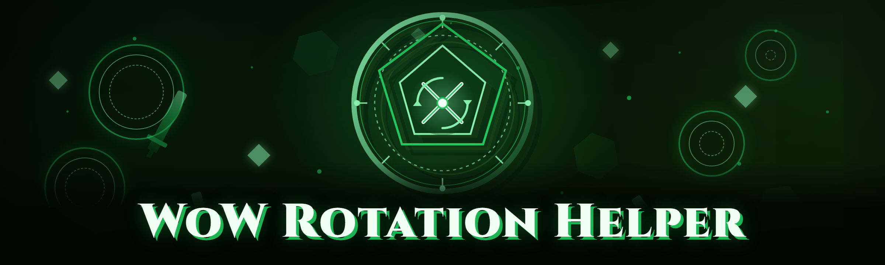

  
  
  

  

  
  
  

---

WoW rotation helper: priority-based spell queue, GCD tracking, proc detection, per-class rotation profiles for retail and Classic.

## Overview

WoW rotation helper: priority-based spell queue, GCD tracking, proc detection, per-class rotation profiles for retail and Classic.

  

## License

[MIT License](LICENSE)

  

